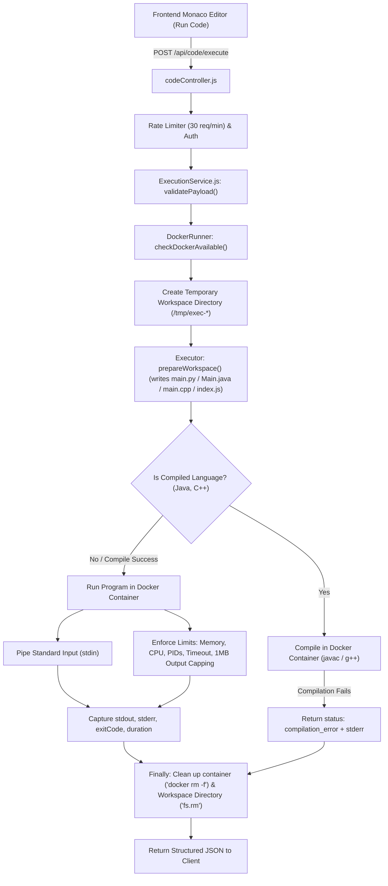

# SkillSwap — Skill Exchange & Collaborative Learning Platform

> **"Don't just learn. Exchange."**  
> SkillSwap connects people who want to teach what they know and learn what they don't. A high-production peer-to-peer learning platform built with the MERN stack, WebRTC, Socket.IO, Monaco Editor, and Tailwind CSS.

---

## 🌟 The Core Vision

Traditional learning platforms force students to pay for generic video courses or expensive hourly tutors. **SkillSwap** reimagines learning as a reciprocal exchange economy:
- **User A** knows **Java & Algorithms** and wants to learn **Video Editing**.
- **User B** knows **Video Editing** and wants to learn **Java**.
- **SkillSwap's Weighted Matching Engine** pairs them with a high compatibility score, helps them agree on a **Learning Contract**, and provides an integrated, real-time **Learning Room** containing **1-to-1 WebRTC video, screen sharing, collaborative Monaco code editor, whiteboard canvas, notes, and chat**.

---

## 🚀 Key Features

### 1. High-Impact Landing Page
- **Hero Banner:** "Don't just learn. Exchange."
- **Animated Skill Exchange Visualizer:** Live interactive visualizer showing reciprocal skill flow between paired mentors (Java ⇄ Video Editing, Python ⇄ UI/UX, React ⇄ Growth).
- **1-Click Demo Launcher:** Instantly log in as **Abhishek (Java)**, **Rahul (Video)**, or **Elena (UI/UX)** to test peer interactions in seconds.
- **Feature Showcase:** Matching engine preview, integrated learning room tour, trust & reputation metrics, and community testimonials.

### 2. Authentication & 5-Step Onboarding Flow
- **Registration & Login:** JWT tokens with bcrypt password hashing and protected routes.
- **5-Step Onboarding Wizard:**
  1. *Basic Profile:* Name, username, avatar, headline, bio, and location.
  2. *What Can You Teach?:* Add multiple skills with proficiency levels (*Beginner, Intermediate, Advanced, Expert*), years of experience, and curriculum descriptions.
  3. *What Do You Want to Learn?:* Target proficiency levels, priorities (*High, Medium, Low*), and specific project goals.
  4. *Availability Matrix:* Select active days, preferred time slots (*Mornings, Afternoons, Evenings*), and hours per week.
  5. *Learning Preferences:* One-to-one vs. Group, format (*Video, Chat, Project-based*), and session lengths.

### 3. Weighted Skill Matching Engine
Does not display random users. Calculates a weighted compatibility score out of **100%**:
- **Mutual Skill Compatibility (50%):** Direct 2-way skill swap compatibility.
- **Availability Overlap (20%):** Matching days and active time slots.
- **Skill Level Compatibility (10%):** Mentor proficiency relative to target learner level.
- **Language Compatibility (10%):** Shared spoken languages.
- **Session Preferences Overlap (10%):** Session format and pacing alignment.
- **"Why You Matched" Breakdown:** Visual breakdown popover detailing specific match highlights.

### 4. Discover & Advanced Search (`/discover`)
- Search by skill name, username, bio, or city.
- Filter by proficiency, available day, minimum rating (e.g., ★ 4.8+), and **Online Now** status.
- User cards displaying avatars, teaching skills with star ratings, learning goals, match score badges, and direct *"Request Skill Exchange"* triggers.

### 5. Exchange Request & Counter-Offer Workflow (`/exchanges`)
- User proposes: *"I can teach you Java"*, *"I want to learn Video Editing"*, customized message, session count, duration, and milestone goals.
- Receiver actions:
  - **Accept:** Automatically creates a signed **Learning Contract** and schedules the kickoff session room!
  - **Counter Offer:** Adjust number of sessions, duration, suggested schedule, or custom terms.
  - **Decline:** Clean status history recording.

### 6. Mutual Learning Contracts
- Formal learning agreement between both users.
- Tracks completed sessions vs. total agreed sessions.
- Interactive milestones & goal checklist (real-time progress bar updates).

### 7. The Main Learning Room (`/session/:sessionId`)
The centerpiece of SkillSwap:
- **1-to-1 WebRTC Video & Audio Calling:**
  - Direct P2P video stream using `RTCPeerConnection` with STUN servers.
  - Camera on/off toggle and Microphone mute/unmute.
  - Graceful hardware permission fallback with diagnostic status alerts.
- **Screen Sharing:**
  - Powered by `navigator.mediaDevices.getDisplayMedia()`.
  - Share full desktop, window, or specific browser tab.
  - Seamlessly restores camera video stream upon stopping screen share without tearing down the peer connection.
- **Collaborative Monaco Code Editor:**
  - Multi-language support: JavaScript (Node.js LTS), Python 3.12, Java (OpenJDK 21), C++ (GCC C++17).
  - Real-time peer code synchronization via Socket.IO.
  - **Isolated Docker-Based Execution Engine:** Runs code inside hardened, disposable Docker containers with strict CPU, memory, process limits, and network isolation.
  - Interactive Standard Input (stdin) panel, runtime duration tracking, and compilation vs. runtime diagnostics.
- **Collaborative Whiteboard Canvas:**
  - HTML5 canvas with pencil, eraser, color palette, stroke width, and board clearing.
  - Real-time peer drawing synchronization.
- **Collaborative Session Notes & File Sharing:**
  - Live session notes with instant save to MongoDB.
  - Multer-powered session file uploads (PDFs, docs, code files) with download links.
- **Real-Time Room Chat:**
  - Instant messaging with timestamps and typing indicators.

### 8. Session Completion & High-Trust Reputation
- **Post-Session Modal:** Confetti celebrations, 1-5 star ratings, what was learned, what was taught, and public review submission.
- **Reputation Metrics:** Verified Teaching Rating, Learning Rating, 99% Reliability Score, Response Rate, and Streak Counters.
- **Earned Badges:** 🏆 *Top Mentor*, 🔥 *Active Streak*, 🎯 *Reliable Partner*.

### 9. Admin Control & Moderation (`/admin`)
- Accessible by users with `role: "ADMIN"`.
- Recharts analytics: 7-day session activity, exchange volume, and top traded skills.
- Member management: View user registry and toggle suspensions.
- Safety queue: Review reports and moderate inappropriate behavior.

---

## 🛠️ Technology Stack

| Layer | Technologies |
|---|---|
| **Frontend** | React 18, Vite, Tailwind CSS, React Router v6, Axios, Socket.IO Client, Monaco Editor (`@monaco-editor/react`), Lucide React, Recharts, Canvas Confetti |
| **Backend** | Node.js, Express.js, MongoDB, Mongoose, Socket.IO, JWT, bcryptjs, Multer, Helmet, CORS, Morgan, Express Rate Limit |
| **Real-Time** | Socket.IO (WebRTC signaling, chat, code sync, whiteboard sync, presence) |
| **Media Stream** | WebSockets for WebRTC signaling; Direct P2P `RTCPeerConnection` for video, audio, and screen sharing |
| **Code Execution** | Isolated Docker Containers, Docker CLI Orchestrator, Extensible Multi-Language Executor Architecture |
| **Containers** | Docker, Docker Compose, Multi-stage Dockerfiles, Hardened Runtime Sandboxes |

---

## 📂 Project Structure

```text
SkillSwap/
├── client/
│   ├── src/
│   │   ├── components/       # Navbar, Footer, NotificationDropdown, MatchScoreBadge, Modals...
│   │   ├── pages/            # LandingPage, Discover, Dashboard, LearningRoom (with Docker Code Runner), Exchanges...
│   │   ├── context/          # AuthContext, SocketContext
│   │   ├── services/         # Axios API client (api.js, codeAPI)
│   │   ├── styles/           # Tailwind and custom animations
│   │   ├── App.jsx           # App routing and protected route wrappers
│   │   ├── main.jsx          # React DOM entry point
│   │   └── index.css         # Glassmorphism utilities, dark gradients, typography
│   ├── index.html
│   ├── Dockerfile            # Multi-stage production Nginx client image
│   ├── nginx.conf            # Nginx reverse proxy configuration
│   ├── package.json
│   ├── tailwind.config.js
│   ├── vite.config.js
│   └── .env.example
│
├── server/
│   ├── config/               # db.js (MongoDB Mongoose connection)
│   ├── controllers/          # auth, user, codeController, matching, exchange, session...
│   ├── middleware/           # auth.js (JWT protect, optionalProtect, adminOnly), upload.js (Multer)
│   ├── models/               # User, Skill, ExchangeRequest, LearningContract, Session, Review...
│   ├── routes/               # RESTful API route definitions (including /api/code)
│   ├── services/
│   │   ├── matchingService.js # Weighted scoring engine
│   │   └── codeExecution/    # Docker-based execution engine
│   │       ├── config.js     # Configurable execution & resource limits
│   │       ├── DockerRunner.js # Secure Docker container runner & concurrency manager
│   │       ├── ExecutionService.js # End-to-end execution lifecycle manager
│   │       └── executors/    # BaseExecutor, Python, Java, C++, JavaScript, Registry
│   ├── sockets/              # Socket.IO signaling, chat, whiteboard, code sync
│   ├── scripts/              # seed.js (Rich demo database seeder)
│   ├── tests/                # Automated unit & integration tests (Node native test runner)
│   ├── uploads/              # Shared session files
│   ├── Dockerfile            # Server image with Docker CLI client orchestration
│   ├── server.js             # Express app entry & HTTP server
│   ├── package.json
│   └── .env.example
│
├── docker/
│   ├── runners/              # Isolated execution environment Dockerfiles
│   │   ├── python.Dockerfile # Python 3.12 unprivileged runner
│   │   ├── java.Dockerfile   # OpenJDK 21 unprivileged runner
│   │   ├── cpp.Dockerfile    # GCC 13 unprivileged runner
│   │   └── node.Dockerfile   # Node.js LTS unprivileged runner
│   ├── pull-runners.sh       # Script to pre-pull runner images (Linux/macOS)
│   └── pull-runners.bat      # Script to pre-pull runner images (Windows)
│
├── docker-compose.yml        # Production-ready full-stack orchestration
├── .dockerignore
├── package.json              # Monorepo root scripts & test runners
└── README.md
```

---

## ⚙️ Environment Variables

### Server (`server/.env`)
```env
PORT=5000
MONGODB_URI=mongodb://127.0.0.1:27017/skillswap
JWT_SECRET=skillswap_super_secret_jwt_key_2026_xyz
JWT_EXPIRE=30d
CLIENT_URL=http://localhost:5173
NODE_ENV=development

# Docker Code Execution Engine Settings
CODE_EXEC_TIMEOUT_MS=5000          # Maximum execution duration in milliseconds (default: 5000ms)
CODE_EXEC_MEMORY_LIMIT=256m        # Container RAM limit (default: 256m)
CODE_EXEC_CPU_LIMIT=1.0            # CPU core allocation limit (default: 1.0)
CODE_EXEC_PIDS_LIMIT=64            # Maximum spawned processes / threads to mitigate fork bombs
CODE_EXEC_MAX_OUTPUT_BYTES=1048576 # 1 MB maximum output buffer
CODE_EXEC_MAX_CODE_SIZE=102400     # 100 KB max source code size
CODE_EXEC_MAX_STDIN_SIZE=102400    # 100 KB max stdin payload size
CODE_EXEC_MAX_CONCURRENT=5         # Maximum parallel container executions on host
DOCKER_CMD=docker                  # Docker CLI command or path
DOCKER_NETWORK=none                # Completely disables network in execution sandbox
DOCKER_READONLY_FS=true            # Mount root filesystem as read-only with /tmp tmpfs

# Runtime Docker Images
DOCKER_IMAGE_PYTHON=python:3.12-slim
DOCKER_IMAGE_JAVA=openjdk:21-slim
DOCKER_IMAGE_CPP=gcc:13-bookworm
DOCKER_IMAGE_NODE=node:20-slim
```

### Client (`client/.env`)
```env
VITE_API_URL=http://localhost:5000/api
VITE_SOCKET_URL=http://localhost:5000
```

---

## ⚡ Docker-Based Code Execution Engine

SkillSwap features a secure, modular, containerized code execution service that runs arbitrary user-submitted programs inside isolated, ephemeral Docker containers rather than directly on the host machine.

### 1. Supported Languages & Environments

| Language | Canonical Key | Aliases | Runtime Image | Compiler / Interpreter | Standard Entrypoint |
|---|---|---|---|---|---|
| **Python** | `python` | `py`, `python3` | `python:3.12-slim` | Python 3.12 | `python -u main.py` |
| **Java** | `java` | `jdk`, `java21` | `openjdk:21-slim` | OpenJDK 21 (`javac`) | `java -Xmx128m -Xss512k Main` |
| **C++** | `cpp` | `c++`, `g++`, `cplusplus` | `gcc:13-bookworm` | GCC 13 (`g++ -std=c++17`) | `./solution` |
| **JavaScript** | `javascript` | `js`, `node`, `nodejs` | `node:20-slim` | Node.js LTS | `node index.js` |

> [!NOTE]
> Adding a new language is modular: create a class inheriting from `BaseExecutor` in `server/services/codeExecution/executors/` and register it in `ExecutorRegistry.js` without changing the core execution service.

### 2. Execution Lifecycle



### 3. API Reference

#### `POST /api/code/execute`
Executes submitted source code inside an isolated Docker container.

- **Rate Limit:** 30 requests / minute per IP
- **Authentication:** Bearer JWT token (optional for demo/testing, verified if present)
- **Request Body:**
  ```json
  {
    "language": "python",
    "code": "import sys\nname = sys.stdin.readline().strip()\nprint(f'Hello, {name} from SkillSwap!')",
    "stdin": "SkillSwapper"
  }
  ```
- **Response Format:**
  ```json
  {
    "success": true,
    "stdout": "Hello, SkillSwapper from SkillSwap!\n",
    "stderr": "",
    "exitCode": 0,
    "executionTime": 142,
    "status": "success"
  }
  ```

#### Possible `status` Values:
- `success`: Execution completed with exit code `0`.
- `compilation_error`: Compilation step (`javac` or `g++`) failed with syntax or symbol errors. Compiler diagnostics are provided in `stderr`.
- `runtime_error`: Program crashed or exited with a non-zero exit code (e.g. uncaught exception, `ZeroDivisionError`, `NullPointerException`, assertion failure).
- `timeout_error`: Execution exceeded the maximum duration limit (default: 5 seconds). The container was killed.
- `system_error`: Docker daemon unreachable, CLI missing, or host environment error.

#### `GET /api/code/languages`
Returns the list of supported languages, versions, starter templates, and active execution limits.

---

## 🔒 Docker Execution Security Architecture

The execution engine is hardened against malicious code execution, container escape, resource starvation, and denial-of-service:

1. **Complete Network Isolation:** Containers run with `--network none`. Arbitrary code cannot access the internet, intranet, MongoDB, host ports, or internal APIs.
2. **Resource Constraints:**
   - Memory capped via `--memory 256m --memory-swap 256m` (OOM killed if exceeded).
   - CPU quota capped via `--cpus 1.0`.
   - Process limit enforced via `--pids-limit 64` (mitigates fork bombs and background daemon spawning).
3. **Execution Timeout:** Strict timer (default: 5s). Upon expiration, `docker kill <containerId>` terminates the container and process group.
4. **Read-Only Root Filesystem:** Root filesystem mounted with `--read-only` and disposable scratch memory `--tmpfs /tmp:rw,noexec,nosuid,size=32m`.
5. **Least-Privilege Non-Root Users:** Containers execute under unprivileged users (`1000:1000` / `sandbox` / `node`).
6. **Workspace Isolation:**
   - Only the specific temporary directory generated per execution (`/tmp/skillswap-code-exec/exec-*`) is mounted.
   - Host directories, system binaries, application code, and database volumes are never mounted.
   - The Docker socket (`/var/run/docker.sock`) is **strictly forbidden** from being mounted inside execution containers.
   - Zero application environment variables or secrets (`JWT_SECRET`, `MONGODB_URI`) are passed to runner containers.
7. **Command Injection Immunity:** The Docker runner uses Node.js `child_process.spawn` and `execFile` with explicit argument arrays. Arguments are never interpolated into shell strings.
8. **Output Buffer Caps:** Streaming output is capped at 1 MB to prevent memory exhaustion from infinite print loops (`while True: print("A")`).
9. **Strict Language Allowlist:** All language identifiers are checked against the registered executor registry. Arbitrary Docker images cannot be specified by clients.
10. **Guaranteed Cleanup:** Container removal (`--rm` and `docker rm -f <containerId>`) and temporary workspace removal (`fs.rm(..., { recursive: true, force: true })`) are guaranteed inside `finally` blocks even during crashes, timeouts, or disconnections.
11. **Concurrency Semaphore & Queueing:** Concurrency is limited to `CODE_EXEC_MAX_CONCURRENT` (default: 5 parallel executions). Requests beyond capacity are queued or rejected with a clean notice.

---

## 🚀 Running SkillSwap with Docker

Deploying SkillSwap with Docker ensures all programming languages and runtimes are pre-packaged without needing to manually install GCC, Python, Java, and Node on the host server.

### 1. Prerequisites
- **Docker Engine** (v20.10+) or **Docker Desktop** (Linux, Windows with WSL2, or macOS)
- **Docker Compose** (v2+)

### 2. Pre-Pull Execution Runner Images
Run the helper script to pre-pull all language runner images in advance:

**Linux / macOS:**
```bash
chmod +x docker/pull-runners.sh
./docker/pull-runners.sh
```

**Windows (PowerShell or CMD):**
```cmd
.\docker\pull-runners.bat
```

Or manually pull the official images:
```bash
docker pull python:3.12-slim
docker pull openjdk:21-slim
docker pull gcc:13-bookworm
docker pull node:20-slim
```

### 3. Start the Full Platform with Docker Compose
```bash
# Build and start all services in detached mode
docker compose up -d --build
```

Services started:
- **`skillswap-server`**: Express API & Socket.IO server on `http://localhost:5000`
- **`skillswap-client`**: Nginx production SPA on `http://localhost:5173`
- **`skillswap-mongo`**: MongoDB database on `localhost:27017`

### 4. Stop Services
```bash
docker compose down
```

---

## 💻 Running SkillSwap Locally (Development Mode)

If developing without Docker Compose, you can run the services directly with Node.js and point to your local Docker daemon for code execution.

### 1. Prerequisites
- **Node.js** v18+ (tested on Node v24)
- **MongoDB** running locally on port 27017 (`mongodb://127.0.0.1:27017`)
- **Docker Desktop / Docker Engine** (running if you want to execute code in Docker)

### 2. Installation
```bash
# Install backend and frontend dependencies
npm run install:all
```

### 3. Seed Demo Data
Populates realistic personas, active exchanges, contracts, and learning rooms:
```bash
npm run seed
```

### 4. Run Development Servers
```bash
# Start backend in terminal 1
npm run dev:server

# Start frontend in terminal 2
npm run client
```

Open **http://localhost:5173** in your browser.

---

## 🧪 Testing

The execution engine includes a comprehensive test suite utilizing Node.js native test runner (`node:test` and `node:assert`).

### Run All Server Tests
```bash
npm test
# Or from server directory:
cd server && npm test
```

### Test Coverage Highlights:
- **Python Execution:** Verified unbuffered output, exit code, stdout capture, and workspace isolation.
- **Java Execution:** Tested automatic public class name detection, multi-stage `javac` compilation, JVM heap limits (`-Xmx128m`), and runtime output.
- **C++ Execution:** Tested GCC `g++ -std=c++17` compilation, diagnostic error reporting, and binary execution.
- **JavaScript Execution:** Tested Node.js LTS execution and stdout/stderr stream capture.
- **Compilation vs Runtime Errors:** Verified compiler diagnostics are tagged with `status: compilation_error` while runtime crashes receive `status: runtime_error`.
- **Execution Timeout:** Tested process kill and timeout classification after deadline expiration.
- **Docker Unavailable Handling:** Verified the engine returns a clean `status: system_error` rather than crashing the server when Docker daemon is down.
- **Resource Limits & Concurrency:** Tested slot acquisition, queue capacity limits, and path normalization across Windows and Linux.
- **Workspace Cleanup:** Verified that temporary directories are completely unlinked after execution.

---

## 🔧 Troubleshooting

### 1. "Docker daemon unavailable"
- Ensure Docker Desktop or Docker Engine is started:
  ```bash
  docker info
  ```
- If running inside a container, verify that `/var/run/docker.sock` is mounted into the container.
- If Docker CLI is at a custom path, configure `DOCKER_CMD=/path/to/docker` in `server/.env`.

### 2. First Execution Takes Longer
- If a language image has not been pulled yet, Docker will download it on first run. Pre-pull images using `docker/pull-runners.sh` or `docker/pull-runners.bat`.

### 3. Java: "Could not find or load main class Main"
- The Java runner automatically detects your public class name (e.g. `public class Solution` becomes `Solution.java` and runs `java Solution`). Ensure your class contains `public static void main(String[] args)`.

### 4. Memory or Output Limit Exceeded
- If your program exceeds 256 MB or 5 seconds, configure `CODE_EXEC_MEMORY_LIMIT` or `CODE_EXEC_TIMEOUT_MS` in `server/.env`.

---

## 👥 Demo Profiles for Dual-Browser Testing

SkillSwap features a **1-Click Demo Switcher** in the navigation bar and on the login page:

| User | Credentials | Teaching Focus | Wants to Learn |
|---|---|---|---|
| **Abhishek Sharma** | `abhishek` / `Password123!` | Java (Expert), DSA | Video Editing, Finance |
| **Rahul Verma** | `rahul` / `Password123!` | Video Editing (Expert), DaVinci | Java, DSA |
| **Alex Rivera** | `alex` / `Password123!` | Python, Machine Learning | UI/UX Design, Figma |
| **Elena Rostova** | `elena` / `Password123!` | UI/UX Design, Figma | Python, Machine Learning |
| **Admin Moderator** | `admin` / `Password123!` | Platform Moderator | — |

### Dual-Window Testing Walkthrough
1. Open **Browser Window 1** (e.g., standard Chrome): Log in as **Abhishek**.
2. Open **Browser Window 2** (e.g., Incognito or Firefox): Log in as **Rahul**.
3. In Window 1, navigate to **Dashboard** or **Sessions** and click **"Join Room Now"** (Room: `SWAP-DEMO-ROOM`).
4. In Window 2, navigate to **Sessions** and enter the same room.
5. Watch the **WebRTC video and audio streams** connect directly.
6. Type code in the **Monaco Code Editor** or sketch on the **Whiteboard** — edits synchronize bidirectionally in real-time over Socket.IO!

---

## 🔒 Security & Architecture Standards
- **Zero Plain-Text Passwords:** Hashed with `bcryptjs` salt rounds.
- **Strict JWT Token Verification:** Validates user existence, token expiration, and suspension status on every protected route.
- **Role-Based Access Control:** Separate middleware checks for standard users and administrators.
- **Media Privacy:** Audio and video streams are transmitted **strictly via WebRTC peer connections**; media never touches Socket.IO servers.
- **Hardened HTTP Headers:** Protected with `helmet` and scoped CORS policies.

---

## 📄 License
This project is licensed under the MIT License.
